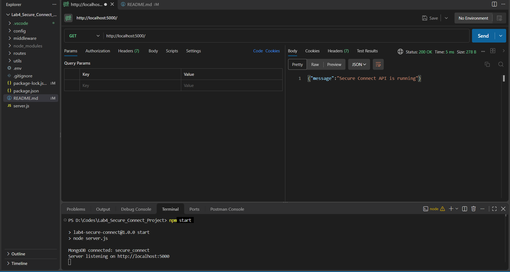
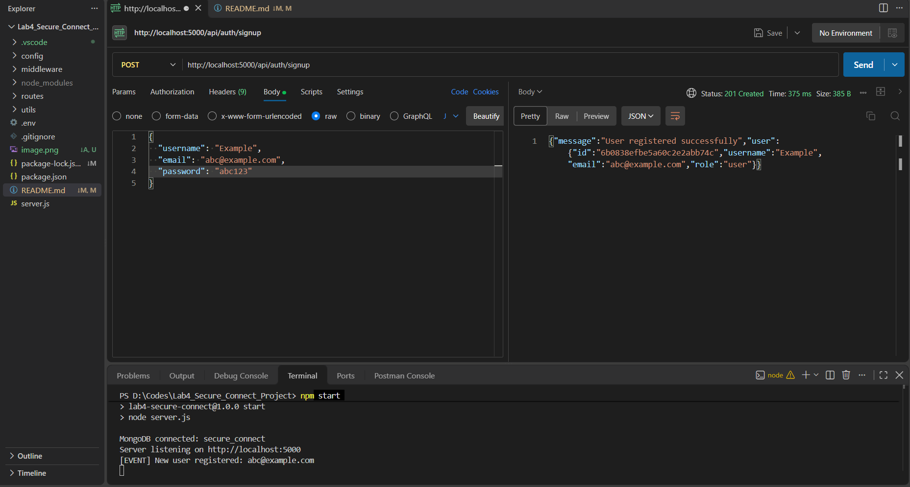
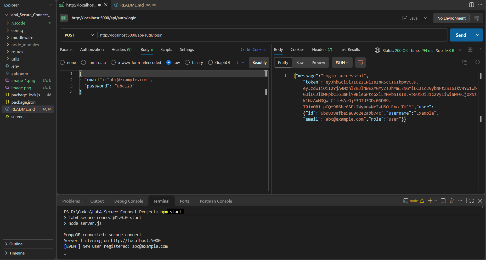
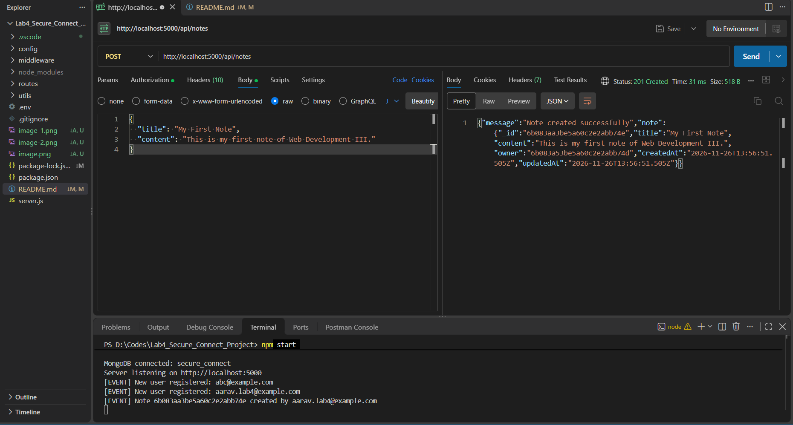
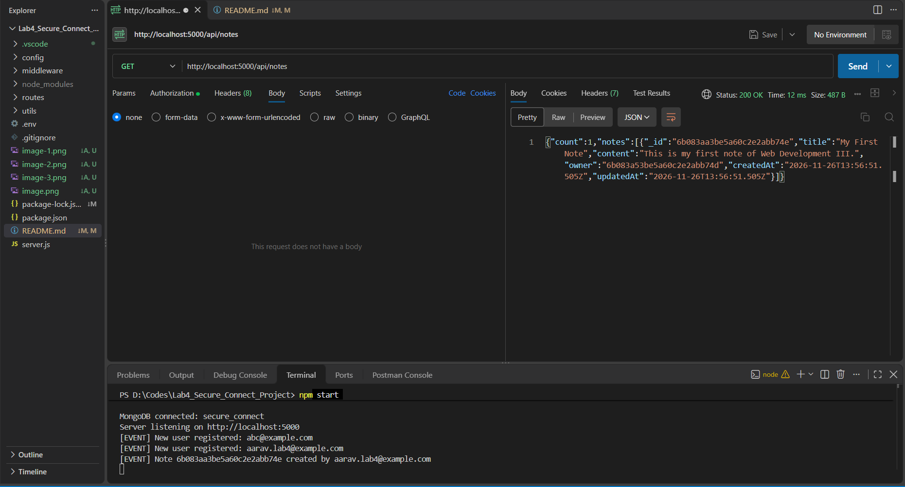
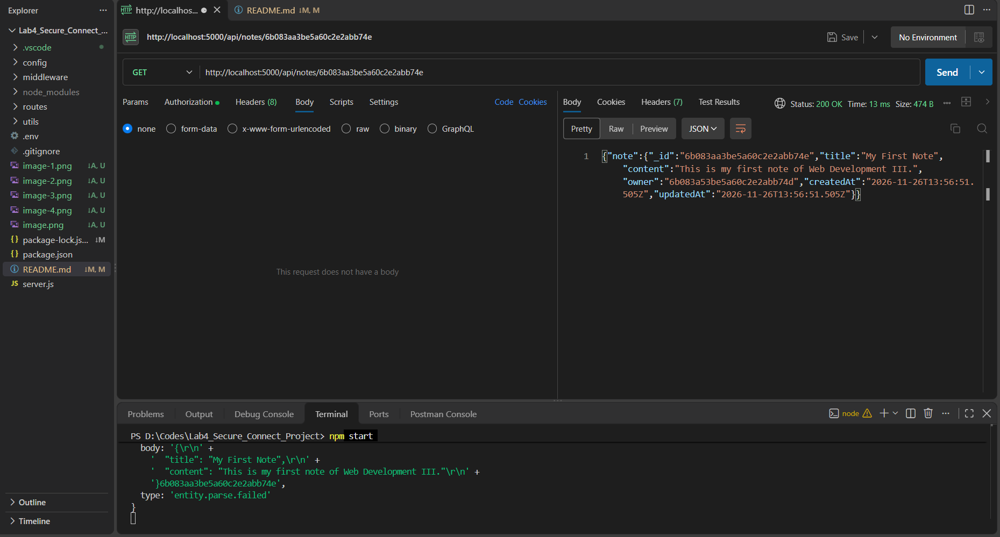
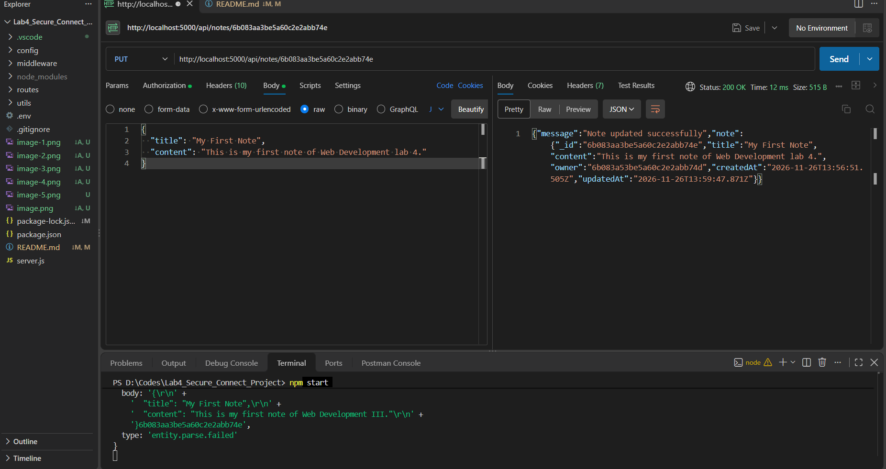
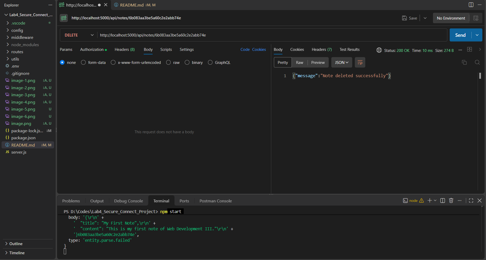

# Lab 4: Secure Connect and Communication Platform

**Course:** Web Dev III  
**Unit:** 4  
**Technology:** Node.js, Express.js, MongoDB, JWT, bcrypt, dotenv, Socket.IO

## 1. Project overview
This project is a secure backend application. Users can register and log in, receive a JWT, access protected endpoints, create and manage private notes, and exchange real-time messages in authenticated chat rooms.

## 2. Requirements
- Node.js 18 or newer
- MongoDB Community Server running locally, or a MongoDB Atlas connection string
- Postman for REST API testing
- Optional: a Socket.IO client (for example, a small Node.js test client) for chat testing

## 3. Installation on Windows
1. Install Node.js and MongoDB.
2. Extract this project folder.
3. Open Command Prompt / VS Code terminal inside the project folder.
4. Run `npm install`.
5. Copy `.env.example` to `.env`.
6. Edit `.env` and set a long random `JWT_SECRET`. Confirm `MONGODB_URI` points to your MongoDB instance.
7. Run `npm start`.
8. The server should display `MongoDB connected: secure_connect` and `Server listening on http://localhost:5000`.

## 4. Environment variables
| Variable | Purpose |
|---|---|
| PORT | Express server port |
| MONGODB_URI | MongoDB connection URI |
| DB_NAME | Database name |
| JWT_SECRET | Secret used to sign and verify JWTs |
| JWT_EXPIRES_IN | Token lifetime |
| BCRYPT_ROUNDS | bcrypt work factor |
| ADMIN_EMAIL | Email that receives admin role when first registered |

**Important:** Never share the real `.env` file or commit it to GitHub. Change the example JWT secret before running.

## 5. API endpoints

All URLs below use `http://localhost:5000`.

| Method | Endpoint | Access | Purpose |
|---|---|---|---|
| GET | `/` | Public | Check server |

| POST | `/api/auth/signup` | Public | Register user |

| POST | `/api/auth/login` | Public | Login and receive JWT |

| GET | `/api/auth/me` | JWT | View authenticated profile |
| GET | `/api/protected` | JWT | Demonstrate protected route |
| GET | `/api/auth/admin/users` | Admin JWT | List users without password hashes |
| POST | `/api/notes` | JWT | Create note |

| GET | `/api/notes` | JWT | List own notes |

| GET | `/api/notes/:id` | JWT | Get one own note |

| PUT | `/api/notes/:id` | JWT | Update own note |

| DELETE | `/api/notes/:id` | JWT | Delete own note |


### Signup
`POST /api/auth/signup`  
Body (JSON):
```json
{
  "username": "Aarav",
  "email": "aarav@example.com",
  "password": "StrongPass123"
}
```
Expected: `201 Created` and `User registered successfully`.

### Login
`POST /api/auth/login`  
Body:
```json
{
  "email": "aarav@example.com",
  "password": "StrongPass123"
}
```
Expected: `200 OK`, `Login successful`, and a JWT token. Copy the token for protected requests.

### Protected request
Set header:
`Authorization: Bearer YOUR_JWT_TOKEN`

Try `GET /api/protected` and `GET /api/auth/me`. Without a token, the API returns `401` with `No token provided`.

### Notes CRUD
For every notes endpoint, set the Bearer token.

Create: `POST /api/notes`
```json
{ "title": "My First Note", "content": "This is my first secure note." }
```
List: `GET /api/notes`  
Read: `GET /api/notes/NOTE_ID`  
Update: `PUT /api/notes/NOTE_ID`
```json
{ "title": "Updated Note", "content": "Updated note content." }
```
Delete: `DELETE /api/notes/NOTE_ID`

Each user can only read, update, or delete notes they own.

## 6. Role-based access control
The account whose email matches `ADMIN_EMAIL` receives the `admin` role when it registers. All other accounts receive the `user` role. The admin-only endpoint is `GET /api/auth/admin/users`. It returns user records without password hashes. Register the configured admin email first if you want to demonstrate this route.

## 7. Real-time chat using Socket.IO
The Socket.IO server shares the HTTP server on port 5000. A client must connect with the JWT in the handshake authentication object:
```javascript
const { io } = require("socket.io-client");

const socket = io("http://localhost:5000", {
  auth: { token: "YOUR_JWT_TOKEN" }
});

socket.on("connect", () => {
  socket.emit("joinRoom", "general");
  socket.emit("chatMessage", {
    room: "general",
    message: "Hello team, backend is ready!"
  });
});

socket.on("joinedRoom", console.log);
socket.on("chatMessage", console.log);
socket.on("connect_error", console.error);
```
For this optional test client, install `socket.io-client` in a separate test folder or use a compatible Socket.IO client. The server-side project uses Socket.IO as required. Messages are broadcast to users in the selected room and logged through EventEmitter.

## 8. Event-driven features
`utils/events.js` uses Node.js EventEmitter. The application emits:
- `user:registered` after successful signup
- `note:created` after a note is created
- `chat:message` after a chat message is broadcast

These events are logged in the server terminal.

## 9. Security features
- Passwords are hashed using bcrypt; plaintext passwords are never stored.
- JWTs are signed with a secret stored in `.env`.
- Protected routes verify JWTs.
- Socket.IO connections also require a valid JWT.
- Notes are scoped to the authenticated user's ID.
- Admin endpoint checks the user's role.
- Input is validated for required fields and note IDs.
- Internal server errors are not exposed to API clients.

## 10. Practical testing checklist
- [ ] Start MongoDB and the Node.js server.
- [ ] Register a normal user.
- [ ] Log in and copy the token.
- [ ] Access `/api/protected` with and without the token.
- [ ] Create, list, read, update, and delete a note.
- [ ] Verify one user cannot access another user's note.
- [ ] Register the configured admin email and test the admin endpoint.
- [ ] Connect two authenticated Socket.IO clients to `general` and exchange messages.
- [ ] Observe EventEmitter messages in the server terminal.

## 11. Conclusion
The Secure Connect and Communication Platform demonstrates backend authentication, authorization, secure password storage, stateless JWT sessions, protected CRUD APIs, role-based access control, and real-time communication. It also demonstrates event-driven programming and secure environment configuration using the technologies specified in Lab 4.

## 12. Submission evidence
Take your own screenshots while running the project:
1. Signup response in Postman.
2. Login response showing the token (hide the token before sharing publicly).
3. Protected route response with a valid token and 401 response without one.
4. Notes creation and notes listing responses.
5. Socket.IO chat messages and server terminal event logs.

The assignment sheet's pages 2–5 show example Postman responses for signup/login and notes, plus a Socket.IO console chat example. Your screenshots should show your own running implementation rather than copied sample screenshots.
